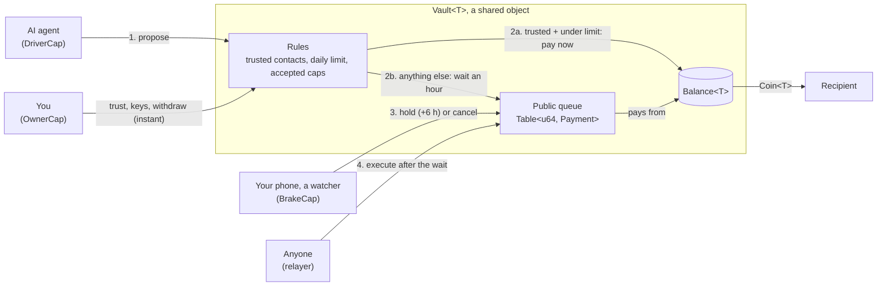
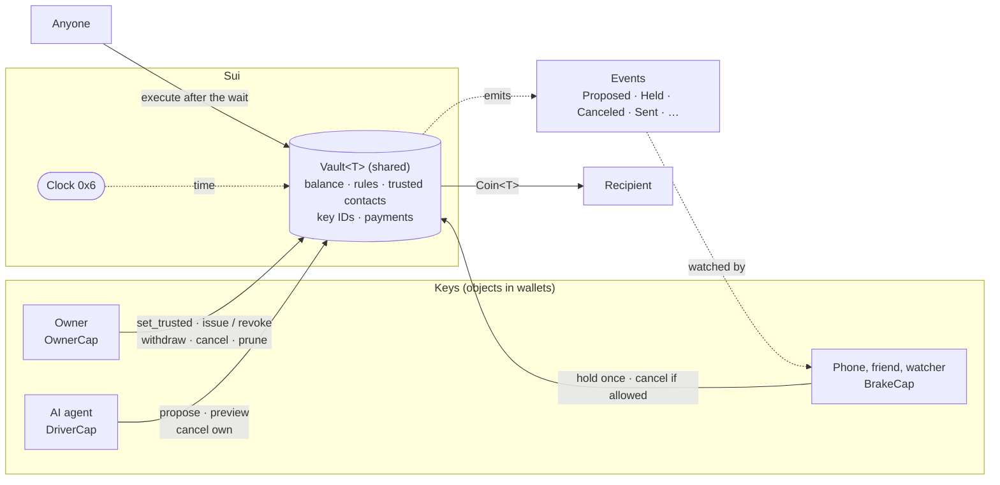
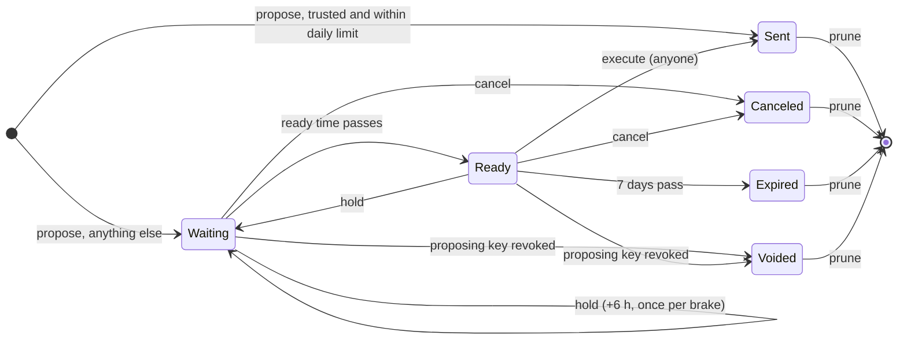

# Brake

A brake pedal for wallets run by AI agents, on Sui.

AI agents are starting to hold wallets, and they can be talked into sending money: in May 2026 a
Morse-code post got Grok to pay out roughly $150–200k from an agent's wallet. A blockchain payment is
final in seconds. Brake adds the two things that were missing: **time**, and **someone who can use
it with a key that can only stop**.

**Try it**

- https://brake-simulation.vercel.app: the whole story in two minutes, no wallet needed
- https://trybrake.vercel.app: the same story on Sui testnet with your own Slush wallet

## How it works

Three kinds of key on one vault:

| Key | Who holds it | Can | Can never |
|---|---|---|---|
| **Driver** | The AI agent | Propose payments | Skip the queue; change the rules |
| **Brake** | Your phone, a friend, a watcher bot, a security firm | Hold a waiting payment once, for a bounded time; cancel it if you allowed that | Send anything |
| **Owner** | You | Everything: trusted contacts, limits, keys (issue or revoke), withdraw | |

What happens to a payment the agent proposes:

- **To a trusted contact, within the daily limit:** goes through at once. That is most payments.
- **Anything else:** waits in a public queue (an hour in the demo). Anyone can watch the queue.
  A brake can hold it longer or cancel it. If nobody stops it, it goes through when the wait ends.
- **Only the owner adds trusted contacts.** The agent can read its own limits and ask you, but it
  can't add anyone, however hard it's pushed.
- **A hold adds six hours from the moment of the hold** (or from when the payment was due, if that is
  later). Each brake holds a given payment once, so the longest delay is six hours per brake.
- **A payment nobody sends in time expires**: seven days after it became ready, in the demo.
- **Revoking a key voids what it queued, for good.** Withdrawing the money does not cancel a queued
  payment: cancel it or revoke the key.
- **The queue never carries the rules.** It holds only a recipient and an amount. Only the owner
  changes the rules, directly.
- **The note on a payment is the agent's words.** A watcher that reads it with a language model treats
  it as data, never as instructions.

The rule that matters most: **a brake key can never move money.** If a brake is stolen or the bot
behind it is tricked, the worst it can do is make you wait.

## Architecture



What happens, step by step:

1. **The agent proposes** a payment (recipient, amount, note) with its `DriverCap`. A payment is only
   ever a recipient and an amount, so the queue structurally cannot carry a rule change.
2. **The rules decide the lane.** (a) To a trusted contact, within today's limit: the vault pays at
   once. (b) Anything else is stored as a `Payment` with a ready time an hour away, and a `Proposed`
   event tells watchers.
3. **Brake keys watch the queue.** A watcher bot or your phone can `hold` a waiting payment (six more
   hours from the hold, once per key) or, with cancel rights, cancel it. No function that takes a
   `BrakeCap` returns a `Coin` or touches the balance; Move's type system enforces it.
4. **After the wait, anyone executes it** by passing the shared `Clock`. If the payment was canceled,
   expired (seven days after ready), or its `DriverCap` was revoked since, it can never be sent.

The owner sits outside the queue: trusted contacts, keys and withdrawing are direct and instant.
That is the main known gap (see "Not yet").

## What's here

| Folder | What |
|---|---|
| [contracts/brake/](contracts/brake/) | The Brake Move package and its 45 tests |
| [contracts/dusd/](contracts/dusd/) | dUSD, a test dollar for testnet, so amounts read in dollars |
| [client/demo/](client/demo/) | The technical demo on Sui testnet (https://trybrake.vercel.app) |
| [client/simulation/](client/simulation/) | The same story in the browser with USDC amounts, no chain or wallet (https://brake-simulation.vercel.app) |

Testnet: Brake package `0xe545ff764833b01d59ecf0da6e068900d82cea629675c328f8d32bcce3008a05`, dUSD
package `0x697839ad30db5c1171f2d7001340d7df46439b15437b74d297fef0e5eb04573e`, dUSD faucet
`0x2f28f1bacb1ca70f778ffa993c08d1fda5f39d85fcfce2be44183c461ec47d83`.

## Architecture



There is one shared object per wallet, the `Vault<T>`. It holds the money, the rules and every
payment the agent has asked for. Nobody owns it, so nobody can move money out of it except
through the module's functions, and each function asks for a specific key:

1. **The agent proposes.** `propose` takes the `DriverCap`. If the recipient is a trusted contact
   and the amount fits today's limit, the coins go out in the same transaction. Otherwise the
   payment is written into the vault with a ready time of now plus the queue wait, and a `Proposed`
   event is emitted.
2. **Watchers see it.** Anyone can read the vault and its events. A watcher (a script, a phone app, a
   friend) that holds a `BrakeCap` sees the queued payment and can `hold` it for six more hours, once,
   or cancel it if its key allows that. Neither call touches the balance.
3. **Anyone finishes it.** Once the ready time has passed, `execute` needs no key at all, so nobody
   has to be awake for a payment to go out. It checks the time against the `Clock`, checks that the
   key that proposed it hasn't been revoked, and only then moves the coins.
4. **The owner sets the rules.** Only the `OwnerCap` can add trusted contacts, issue or revoke keys,
   withdraw, or clear old records. The queue can never change the rules: a payment carries only a
   recipient, an amount and a note.

A payment moves through these states:



Only `Waiting`, `Sent` and `Canceled` are stored. `Ready`, `Expired` and `Voided` are worked out
when someone reads or acts on the payment, from the `Clock` and the vault's list of live keys. That
way a payment expires, or dies with a revoked key, without anyone having to send a transaction.

The two apps in [client/](client/) tell the same story through one interface, `Chain` in
`src/chains/types.ts`. The UI calls `propose`, `hold`, `cancel` and `execute` on it and never talks
to a network directly. In the demo the interface builds Sui transactions against the testnet
package. In the simulation it runs the same rules in memory.

## How it maps to Sui

Sui is the most natural home for Brake. The three keys become **capability objects**: whoever holds
the object holds the key, and Move's type system decides what each one can do.

| Brake concept | On Sui |
|---|---|
| Wallet | `Vault<T>`, a shared object holding a `Balance<T>`, the rules, trusted contacts and waiting payments |
| Driver key | `DriverCap`, an object sent to the agent's address |
| Brake key | `BrakeCap { can_cancel }`, sent to your phone, a friend or a watcher |
| Owner key | `OwnerCap`, kept by you |
| Trusted contacts | `Table<address, bool>` inside the vault |
| Payment | `Payment` in a `Table<u64, Payment>`: recipient, amount, note, ready time, who held it, state. Expires `expiry_ms` after its ready time |
| Time | The shared `Clock` object (`0x6`) |

Each cap records which vault it belongs to, and the vault keeps the set of cap IDs it still accepts,
so the owner can revoke a lost phone's cap without getting the object back.

## Why the brake can't steal, on Sui

No function that takes a `BrakeCap` returns a `Coin` or touches the balance. That is not a check
someone could get wrong at runtime; the module simply exposes no such path, and the compiler
enforces it.

## Functions

| Function | Needs | Does |
|---|---|---|
| `create<T>(queue_ms, max_hold_ms, expiry_ms, daily_limit, funds)` | | Creates and shares the vault, returns the `OwnerCap`. `new` + `share` do the same in two steps so one transaction can also issue keys |
| `propose` | `&DriverCap` | Pays at once if trusted and within today's limit; otherwise queues it |
| `hold` | `&BrakeCap` | Pushes a payment back by the max hold, counted from the hold (or its due time, if later). Once per brake per payment. Can't revive an expired payment |
| `cancel_as_owner`, `cancel_as_brake`, `cancel_as_driver` | `&OwnerCap`; a `&BrakeCap` with cancel rights; or the `&DriverCap` that proposed it | Kills it; nothing moves |
| `cancel_many_as_owner` | `&OwnerCap` | Cancels a list of payments in one transaction, skipping finished, pruned or unknown numbers |
| `execute` | Nothing (anyone), after the ready time and before expiry | Pays the recipient. Aborts if the proposing key was revoked |
| `set_trusted` | `&OwnerCap` | Adds or removes a trusted contact |
| `issue_driver`, `issue_brake`, `revoke` | `&OwnerCap` | Hands out and takes back keys. Revoking voids the key's waiting payments |
| `deposit`, `withdraw` | Anyone; `&OwnerCap` | Moves coins in; the owner takes coins out |
| `prune` | `&OwnerCap` | Deletes the record of a sent, canceled, expired or voided payment |
| `preview`, `payment_state`, `payment_ready_ms`, `has_payment`, `balance`, `is_trusted`, `is_key`, `config`, `payment_count` | Nothing (read-only) | What the agent and watchers read |

Events: `Proposed`, `Held`, `Canceled`, `Sent`, `Pruned`, `TrustedSet`, `KeyIssued`, `KeyRevoked`,
`Deposited`, `Withdrawn`. Payment states: 0 waiting, 1 ready, 2 sent, 3 canceled, 4 expired, 5 voided
(still waiting, but its key was revoked, so it can never be sent; no `Canceled` event is emitted for
it, so a watcher derives voiding from `KeyRevoked` or reads `payment_state`). A read of a pruned
number aborts; `has_payment` says whether a record still exists.

The `note` on a payment is at most 256 bytes and is the driver's own words: a watcher that reads it
with a language model must treat it as data, never as instructions. Withdrawing from the vault does
not cancel queued payments; cancel them or revoke the key. To rotate the agent key, issue the new
`DriverCap` first, let the old key's queue drain or re-propose it, then revoke the old one: revocation
voids its waiting payments for good.

The caps have `store`, so an owner can wrap the `OwnerCap` in another object (a future timelock, a
multisig). The flip side: signing `public_freeze_object` on it, or `public_share_object` in the same
transaction that created it, would make it usable by anyone. Treat the `OwnerCap` like the seed
phrase it effectively is, and read what a setup transaction does with it before approving.

## Run the tests

```sh
sui move test --path contracts/brake # Brake, 45 tests
sui move test --path contracts/dusd  # dUSD, 2 tests
```

Tests use a test clock that can be moved forward, so every wait, hold and expiry is checked.

## Run the demos

- Technical demo: see [client/demo/README.md](client/demo/README.md). It runs against the testnet package with your
  own Slush wallet. A local network (`sui start`) can't jump forward in time, so the "ignore the
  alert" ending, which needs the hold to run out, appears only in the simulation.
- Simulation: see [client/simulation/README.md](client/simulation/README.md). No chain, keys or `.env` needed.

## Upgrades

The testnet package keeps its `UpgradeCap` (see [contracts/brake/Published.toml](contracts/brake/Published.toml)) so milestone changes can be
republished. Until that cap is burned, whoever holds it could publish a version that moves coins, so
"a brake key can never move money" is a property of this code, not yet of the deployment. Before any
mainnet publish the cap is made immutable (`sui::package::make_immutable`) or put behind a delayed
multisig, and the transaction is linked here.

## Not yet

- The owner's own changes are instant: trusted contacts, limits, keys, withdrawing. A stolen owner key
  is game over, as with any wallet. An optional delay on the owner's side is the first milestone
- Daily limits count per UTC day, not per rolling 24 hours, so up to twice the limit can go out around
  midnight. A rolling window is planned
- Per-amount waits (a short wait for small unknown payments, a longer one for big ones)
- The watcher in the demo is a script; a real watcher service with alerts is a milestone
- An external security review. Nothing here should hold real money until one is done

## Security

See [SECURITY.md](SECURITY.md) to report a problem.

## License

MIT, see [LICENSE](LICENSE).
